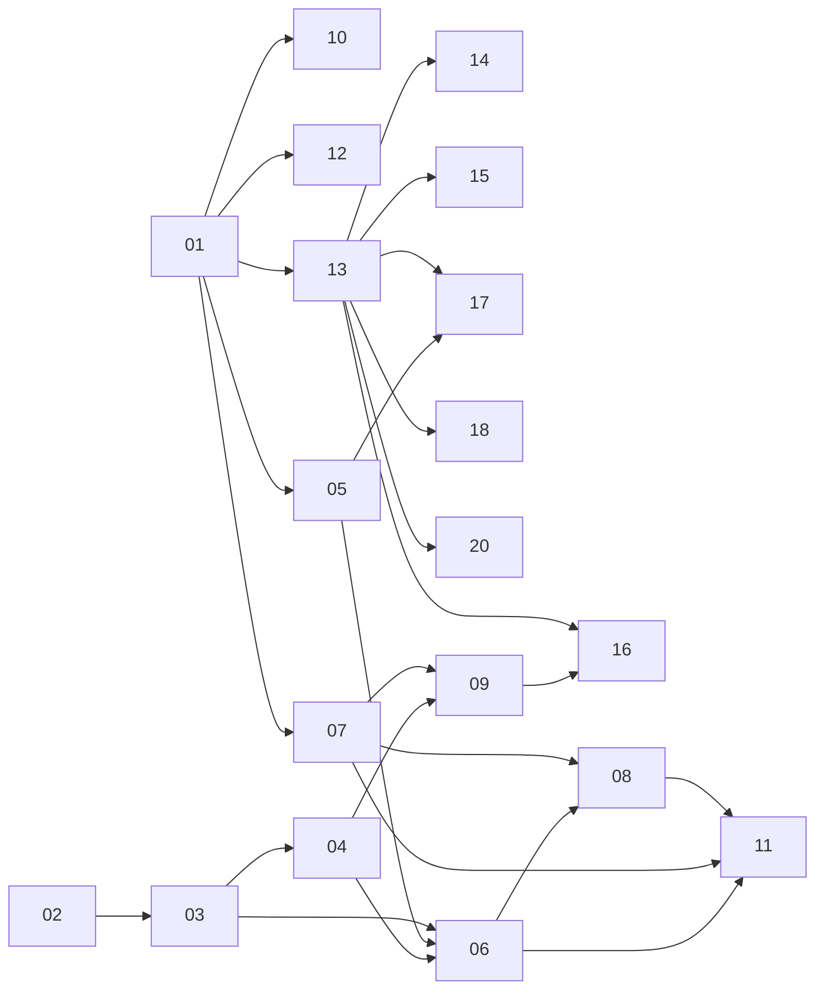

# MathWars: the project, split into tasks

Each file in this folder is a self-contained brief for one AI agent. To hand one off, tell the agent:

> Read `tasks/README.md`, then do `tasks/NN-name.md`. Work on a new branch and open a pull request when the acceptance criteria pass.

Every brief has the same sections: **Goal**, **Depends on**, **Read first**, **Deliverables**, **Spec**, **Acceptance criteria** and **Out of scope**. An agent should do only what its brief says and write down anything it had to decide in its pull request description.

## Where things stand

The live first draft is a single `index.html`, served at https://kevinvariant08.github.io/mathwars/. It has 21 hand-written seed problems, answer checking against hashes in the page, progress saved in `localStorage`, ghost duels and a sample leaderboard. The problems are thin and uneven, and fixing that is the priority. Most of Phase B exists to do it.

## Phases and order

| # | Task | Phase | Depends on | Size |
|---|------|-------|------------|------|
| 01 | [Restructure the repo and define the problem data format](01-repo-and-problem-format.md) | A. Foundations | — | M |
| 02 | [Build the private AIME corpus](02-aime-corpus.md) | B. Content | — | M |
| 03 | [Analyse and tag the AIME corpus](03-corpus-analysis.md) | B. Content | 02 | M |
| 04 | [Write the MathWars problem standard](04-problem-standard.md) | B. Content | 03 | S |
| 05 | [Build the verification gate](05-verification-gate.md) | B. Content | 01 | L |
| 06 | [Generate original AIME-level problems](06-generate-aime-originals.md) | B. Content | 03, 04, 05 | L |
| 07 | [Build the review queue](07-review-queue.md) | B. Content | 01, 05 | M |
| 08 | [Extend the pipeline to 8–6 kyu](08-lower-kyu-content.md) | B. Content | 06, 07 | L |
| 09 | [Build the proof-problem pipeline (3–1 kyu)](09-proof-problems.md) | B. Content | 04, 07 | L |
| 10 | [Diagrams for geometry problems](10-diagrams.md) | B. Content | 01 | M |
| 11 | [Replace the seed set and fill the ladder](11-replace-seed-set.md) | B. Content | 06, 07, 08 | S |
| 12 | [Frontend polish for a bank of hundreds](12-frontend-polish.md) | C. Product | 01 | L |
| 13 | [Accounts and server-side answer checking](13-accounts-and-server-checking.md) | C. Product | 01 | L |
| 14 | [Live duels with friends](14-live-duels.md) | C. Product | 13 | M |
| 15 | [Leaderboards, public profiles and clans](15-leaderboards-and-clans.md) | C. Product | 13 | M |
| 16 | [Proof submission and review](16-proof-review.md) | C. Product | 09, 13 | L |
| 17 | [Community problem authoring and beta](17-community-authoring.md) | C. Product | 05, 13 | L |
| 18 | [Calibrate kyu from real solve data](18-difficulty-calibration.md) | C. Product | 13 | M |
| 19 | [Name, brand and launch assets](19-brand.md) | D. Launch | — | S |
| 20 | [Kevinvariant integration](20-kevinvariant-integration.md) | D. Launch | 13 | S |

S is about one agent session, M is a few, and L needs a pilot first and then a scaled run.

### What can run at the same time

- **Start immediately, in parallel:** 01, 02 and 19.
- **After 01:** 05, 07, 10, 12 and 13 are independent of each other.
- **After 02:** 03, then 04.
- **The content line** is 03 → 04 → 06 → 08 → 11, with 05 and 07 required before 06 scales up.
- **After 13:** 14, 15, 17, 18 and 20 can run in parallel.

## Rules every agent follows

1. **Contest problems stay private.** AMC, AIME, UKMT, BMO and olympiad problem texts are copyrighted by their organisers. The corpus lives in a separate **private** repo (`mathwars-corpus`, see task 02) and is never committed here, never shown on the site and never pasted into public pull requests. This repo may hold IDs such as `AIME-2019-I-07`, statistics and abstract technique tags, but no problem text.
2. **Published problems are original.** A generated problem must keep the technique and the difficulty of its inspiration, but not its setting, numbers or wording. Task 05's novelty check enforces this.
3. **No secrets in git.** API keys come from environment variables (`ANTHROPIC_API_KEY` and so on). The Supabase publishable key is public by design; the service-role key never leaves the server.
4. **Models.** Use `claude-opus-5-5` for generation and judging and `claude-sonnet-5-5` for bulk blind solves. Where a brief asks for an independent second opinion, use a different model so the errors aren't correlated. Log the model ID and the cost of every pipeline run.
5. **Pilot, then scale.** Any task that calls a model in bulk runs a pilot of about 30 items first and stops for Kevin to look at it before the full run.
6. **No build step for the site** unless task 01 decides otherwise. It must keep working as static files on GitHub Pages.
7. **Same origin as Kevinvariant.** The site is served from `kevinvariant08.github.io/mathwars/`, so it shares an origin with Kevinvariant: `localStorage` and the Supabase session are shared. Prefix every storage key with `mathwars:`.

## Decisions Kevin should make before the content line scales

- Whether published problems show which contest problem inspired them. The recommendation is no: keep that mapping private, and label problems only as "AIME-level".
- Whether famous olympiad problems (IMO 1988 P6 and similar) can appear with attribution at 1–2 kyu, or whether the bank should be 100% original.
- The monthly API budget for tasks 06, 08 and 09.
